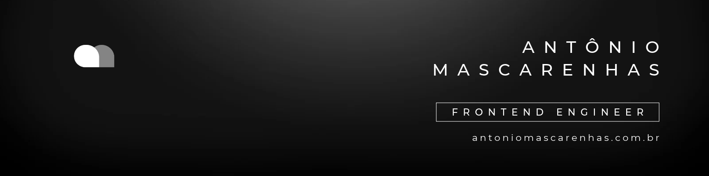

<b>English</b> · <a href="README.md">Português (BR)</a>

<!-- # Antônio Mascarenhas -->

### Software Engineer | Frontend Specialist

Building scalable web applications and digital experiences
with a focus on **software quality, performance and accessibility**.

  <code>React</code> • <code>Next.js</code> • <code>TypeScript</code> • <code>Node.js</code>

[Website](https://antoniomascarenhas.com.br) ·
[LinkedIn](https://linkedin.com/in/antoniomascarenhas) ·
[Email](mailto:contato@antoniomascarenhas.com.br)

---
## 👨‍💻 About Me

I'm a Software Engineer with 5+ years of experience in Frontend Development, focused on building modern, scalable and user-centered web applications.

My professional experience includes:

- Developing web applications with **React, Next.js and TypeScript**.
- Designing and maintaining reusable components and **Design Systems**.
- Integrating REST and GraphQL APIs.
- Improving web performance, accessibility and user experience.
- Collaborating with product, design and engineering teams.

I'm currently pursuing a **Postgraduate Specialization in Software Engineering at PUC Minas**, expanding my knowledge in software architecture, distributed frontend architectures and AI-assisted software development.

I'm particularly interested in how engineering practices and emerging technologies can improve the way we design, build and maintain software.

## 🛠️ Tech Stack

**Frontend Development**

**UI Engineering**

**APIs & Backend**

**Tools & Workflow**

<!--

## 🚀 Featured Projects

> A selection of projects that represent my experience, technical interests and continuous learning.

### Project Name

**Short description of the project and the problem it solves.**

- **My contribution:** Describe what you designed, implemented or improved.
- **Technical highlights:** Mention architecture, integrations or interesting challenges.
- **Technologies:** React, Next.js, TypeScript, etc.

[Repository](https://github.com/your-username/project) · [Live Demo](https://example.com)

---

### Project Name

**Short description of the project and its purpose.**

- **My contribution:** Explain your role in the project.
- **Technical highlights:** Describe an important technical decision.
- **Technologies:** React, TypeScript, Node.js, etc.

[Repository](https://github.com/your-username/project) · [Live Demo](https://example.com)

---

### Project Name

**A project focused on exploring new technologies and software engineering practices.**

- **My contribution:** Describe what you built.
- **Technical highlights:** Explain what you learned or implemented.
- **Technologies:** Next.js, Node.js, PostgreSQL, etc.

[Repository](https://github.com/your-username/project)
-->

## 📚 Currently Exploring

- **Software Architecture:** Microfrontends, architectural patterns and scalable applications.
- **AI-Assisted Development:** Applying AI tools and workflows to software engineering.
- **Backend Development:** Node.js, API design and database integration.
- **Software Quality:** Automated testing, maintainability and engineering best practices.

## 🤝 Let's Connect

I'm always interested in connecting with people, exchanging knowledge and discussing software engineering, technology and product development.

<!--
---

*"Good software is built with curiosity, thoughtful decisions and continuous improvement."*

-->