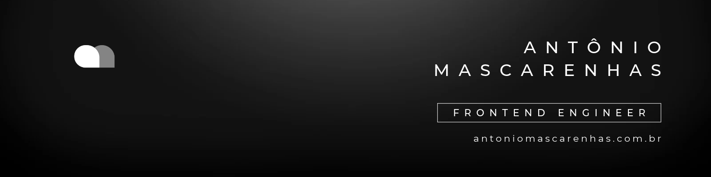

<a href="README.en.md">English</a> · <b>Português (BR)</b>

<!-- # Antônio Mascarenhas -->

### Engenheiro de Software | Especialista em Frontend

Construindo aplicações web escaláveis e experiências digitais
com foco em **qualidade de software, performance e acessibilidade**.

  <code>React</code> • <code>Next.js</code> • <code>TypeScript</code> • <code>Node.js</code>

[Website](https://antoniomascarenhas.com.br) ·
[LinkedIn](https://linkedin.com/in/antoniomascarenhas) ·
[E-mail](mailto:contato@antoniomascarenhas.com.br)

---
## 👨‍💻 Sobre Mim

Sou Engenheiro de Software com mais de 5 anos de experiência em Desenvolvimento Frontend, focado em construir aplicações web modernas, escaláveis e centradas no usuário.

Minha experiência profissional inclui:

- Desenvolvimento de aplicações web com **React, Next.js e TypeScript**.
- Criação e manutenção de componentes reutilizáveis e **Design Systems**.
- Integração de APIs REST e GraphQL.
- Melhoria de performance, acessibilidade e experiência do usuário na web.
- Colaboração com times de produto, design e engenharia.

Atualmente cursando **Pós-graduação (Especialização) em Engenharia de Software na PUC Minas**, aprofundando meus conhecimentos em arquitetura de software, arquiteturas frontend distribuídas e desenvolvimento de software assistido por IA.

Tenho especial interesse em como práticas de engenharia e tecnologias emergentes podem melhorar a forma como projetamos, construímos e mantemos software.

## 🛠️ Tech Stack

**Desenvolvimento Frontend**

**Engenharia de UI**

**APIs e Backend**

**Ferramentas e Fluxo de Trabalho**

## 📚 Estudando Atualmente

- **Arquitetura de Software:** Microfrontends, padrões arquiteturais e aplicações escaláveis.
- **Desenvolvimento Assistido por IA:** Aplicação de ferramentas e fluxos de IA na engenharia de software.
- **Desenvolvimento Backend:** Node.js, design de APIs e integração com bancos de dados.
- **Qualidade de Software:** Testes automatizados, manutenibilidade e boas práticas de engenharia.

## 🤝 Vamos nos Conectar

Tenho sempre interesse em me conectar com pessoas, trocar conhecimento e conversar sobre engenharia de software, tecnologia e desenvolvimento de produtos.

